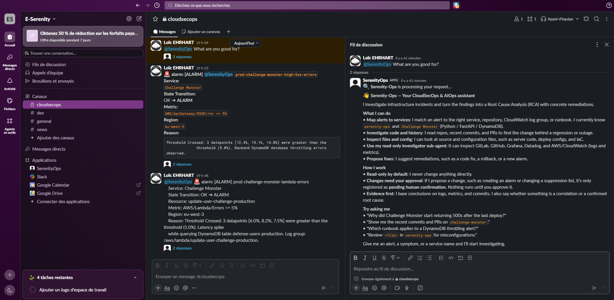
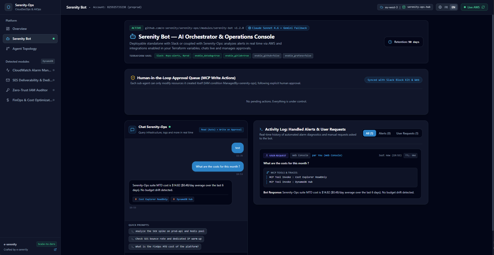

# 🛡️ Serenity-Ops

**Modular, Self-Hosted CloudSecOps & AIOps Platform for AWS, Deployed via Terraform.**

[](https://github.com/e-serenity/terraform-aws-serenity-ops/actions/workflows/ci.yml)
[](https://github.com/e-serenity/terraform-aws-serenity-ops)
[](https://registry.terraform.io/modules/e-serenity/serenity-ops/aws/latest)
[](https://github.com/e-serenity/terraform-aws-serenity-ops)
[](https://github.com/e-serenity/terraform-aws-serenity-ops/blob/main/SECURITY.md)
[](https://e-serenity.fr/serenity-ops/)
[](https://github.com/e-serenity/terraform-aws-serenity-ops/blob/main/LICENSE)

**[🌐 Interactive Live Demo](https://e-serenity.fr/serenity-ops/) · [Usage](#usage) · [Examples](#examples) · [Architecture & Security](https://github.com/e-serenity/terraform-aws-serenity-ops/blob/main/docs/architecture.md) · [Module Catalog & Deployment Guide](https://github.com/e-serenity/terraform-aws-serenity-ops/blob/main/docs/deployment-guide.md) · [Documentation](#documentation--community)**

[The Problem](#the-problem) · [Why Serenity-Ops?](#why-serenity-ops) · [Core Features](#core-features)

`source = "e-serenity/serenity-ops/aws"` · `source = "e-serenity/serenity-ops/aws//modules/<module>"`

**💬 Slack Bot & Investigations**



**🌐 Web Console & Live Hub (Full suite)**



> **Tip:**
> **Try the Interactive Live Demo:** Explore the full web console (toggle modules on the fly, test *AI-Optional* behavior, review *Human-in-the-Loop* approvals, inspect agent IAM boundaries, and switch between `EN / FR`) at **[https://e-serenity.fr/serenity-ops/](https://e-serenity.fr/serenity-ops/)**.

## The Problem

Operating production workloads on AWS often comes down to difficult trade-offs between incident speed, data privacy, and IAM safety:

- **Alert Fatigue.** When a CloudWatch alarm fires in Slack, engineers have to jump across CloudWatch Logs, CloudTrail, ECS, GitLab/GitHub, and Datadog to find which commit or resource caused the spike.
- **External SaaS Data Ingestion.** Third-party AIOps platforms require cross-account IAM roles and ship production logs outside your AWS boundary, often with unpredictable per-GB pricing.
- **Unbounded AI Permissions.** Giving an LLM broad write access to a production AWS account is unsafe without strict IAM tag boundaries and mandatory human validation.

## Why Serenity-Ops?

**Serenity-Ops** is a self-hosted suite of Terraform modules deployed inside your own AWS account. Your logs, metrics, and AI prompts (via **AWS Bedrock**) stay within your AWS account and Slack workspace.

| Capability | External AIOps SaaS | HolmesGPT (Open Source) | AWS CloudWatch Investigations | 🛡️ **Serenity-Ops** |
| :--- | :--- | :--- | :--- | :--- |
| **Primary Target** | Multi-cloud SaaS | **Kubernetes / Helm-first** | AWS Console-native | **Terraform + AWS ECS / Serverless-first** |
| **Data Sovereignty** | Third-party cloud (Cross-Account IAM) | Self-hosted (BYO LLM API / Bedrock) | Your AWS account | **Your AWS Account** (AWS Bedrock + Slack) |
| **External Git & APM Context** | Vendor connectors | Broad plugin ecosystem (Prometheus, K8s...) | AWS-only (limited external Git/APM) | **Native GitLab, GitHub, Datadog, Grafana + Terraform `application_context` map** |
| **AI Write Model** | Risky broad IAM roles | Read-only by design (or RBAC / Git PRs) | Read-only + Runbook links | **Human-in-the-Loop (`Approve`/`Reject`) + `sts:AssumeRole` Tag Boundary (`ManagedBy=serenity-ops`)** |
| **Web Console & Modularity** | Monolithic SaaS UI | CLI / Slack / Robusta SaaS UI | AWS Console | **Self-Hosted CloudFront Web Console + Composable Modules** (`core`, `bot`, `ses`) |
| **Network Surface** | Public inbound webhooks | In-cluster / outbound | AWS internal | **Zero Inbound Ports** (Slack Socket Mode + CloudFront OAC + Edge IP Filter) |
| **Infrastructure Cost** | Per-GB / per-seat SaaS billing | K8s cluster compute + LLM tokens | Included / usage-based | **Core Hub: $0/hr idle** · **Bot: ~$4/mo on existing ECS** (or ~$35–$40/mo with dedicated NAT/Endpoints) + Bedrock tokens |

### Core Features

- **Real-Time Alert Analysis (RCA):** When an alert lands in Slack or EventBridge, `serenity-bot` correlates events across AWS services (`CloudWatch Alarms/Metrics/Logs`, `ECS`, `RDS`, `CloudTrail`, `DynamoDB`, `Lambda`, plus custom MCP servers) alongside your Terraform-enabled integrations (`GitHub`, `GitLab`, `Datadog`, `Grafana`) and your declarative `application_context` map to post the root cause in-thread.
- **Web & Slack Chatbot:** Query your infrastructure, logs, and metrics in plain English from Slack or from the built-in Web Console (`Chat Serenity-Ops`).
- **Human-in-the-Loop Remediation:** The bot task role is scoped to a least-privilege AWS observability policy (`CloudWatch`, `Logs`, `ECS`, `RDS`, `CloudTrail`, `DynamoDB`/`Lambda` metadata — no `s3:GetObject` or `dynamodb:GetItem/Scan` on application tables, with optional opt-in via `bot_enable_aws_readonly_access`). Write actions never run silently: every proposed change generates a `PENDING` approval request (`Approve` / `Reject`) in both Slack and the Web Dashboard, and only assumes a tag-scoped sub-agent IAM role (`sts:AssumeRole` with `ManagedBy=serenity-ops`) upon human approval.
- **Composable & AI-Optional:** Deploy `serenity-ses` standalone to protect your SES sender reputation, deploy `serenity-bot` standalone connected to your Slack channels, or connect the full suite through the `serenity-ops-hub` table.
- **Serverless Web Console:** Deployed to a private S3 bucket and ARM64 Live API Lambda (`/api/*`) behind CloudFront OAC, reading your `serenity-ops-hub` DynamoDB table with Edge IPv4/IPv6 filtering (`dashboard_allowed_ips`) and `EN / FR` support.

## Usage

```hcl
module "serenity_ops" {
  source  = "e-serenity/serenity-ops/aws"
  version = "~> 0.1"

  project_name = "serenity-ops"
  environment  = "prod"
  region       = "eu-west-3"

  # Composable module switches
  enable_core = true  # DynamoDB Hub + CloudFront Web Console ($0/hr idle)
  enable_bot  = true  # Slack Socket Mode + AWS Bedrock RCA orchestrator
  enable_ses  = false # AWS SES v2 reputation & bounce/complaint pipeline

  dashboard_allowed_ips = ["203.0.113.10/32"]
  enable_github         = true

  # Credentials: created as a Secrets Manager placeholder by default (populate in AWS Console),
  # or pass an existing secret ARN so tokens never touch Terraform state:
  # bot_create_secrets      = false
  # bot_existing_secret_arn = "arn:aws:secretsmanager:eu-west-3:123456789012:secret:serenity-bot-prod"
}
```

Or deploy any module standalone via submodule syntax (`source = "e-serenity/serenity-ops/aws//modules/serenity-bot"`). See [`docs/deployment-guide.md`](https://github.com/e-serenity/terraform-aws-serenity-ops/blob/main/docs/deployment-guide.md) for all patterns.

### Prerequisites

| Requirement | Details |
| :--- | :--- |
| **Terraform** | `>= 1.10` |
| **AWS credentials** | IAM permissions to provision VPC, ECS, IAM, DynamoDB, S3, CloudFront, Lambda, and Secrets Manager resources. |
| **Amazon Bedrock access** | Anthropic Claude models enabled in your target AWS region (one-time use-case form in the Bedrock console for first-time accounts). |
| **Slack workspace** | Slack app configured with **Socket Mode** (`SLACK_BOT_TOKEN` & `SLACK_APP_TOKEN`). See [`docs/slack-app.md`](https://github.com/e-serenity/terraform-aws-serenity-ops/blob/main/docs/slack-app.md). |

**Optional**

- **GitHub / GitLab / Datadog / Grafana tokens**: populate in AWS Secrets Manager when enabling the corresponding integrations (`enable_github`, `enable_gitlab`, ...).
- **`GEMINI_APIKEY`**: only if you want the Google Gemini fallback. ⚠️ Note that enabling this fallback sends prompts outside your AWS account.

## Examples

Runnable reference configurations are included under [`examples/`](https://github.com/e-serenity/terraform-aws-serenity-ops/tree/main/examples):

- **[`examples/bot`](https://github.com/e-serenity/terraform-aws-serenity-ops/tree/main/examples/bot)** — Standalone `serenity-bot` deployment (Slack Socket Mode + AWS Bedrock RCA + self-contained VPC/ECS).
- **[`examples/full`](https://github.com/e-serenity/terraform-aws-serenity-ops/tree/main/examples/full)** — Complete suite via the root module (`serenity-core` Hub & CloudFront Web Console + `serenity-bot` + `serenity-ses`).

```bash
cd examples/full
terraform init
terraform apply
```

After `terraform apply`, populate your Slack tokens (`SLACK_BOT_TOKEN`, `SLACK_APP_TOKEN`) in the created AWS Secrets Manager secret (`bot_secrets_manager_secret_arn` output) — or pass `bot_create_secrets = false` with `bot_existing_secret_arn` — and follow **[`docs/slack-app.md`](https://github.com/e-serenity/terraform-aws-serenity-ops/blob/main/docs/slack-app.md)** to invite the bot to your alert channels.

## Documentation & Community

- **[Architecture, Security & Cost Design (`docs/architecture.md`)](https://github.com/e-serenity/terraform-aws-serenity-ops/blob/main/docs/architecture.md):** Global architecture diagram, repository structure, IAM 3-layer security model, network/FinOps modes, and LLM Bedrock/Fallback strategy.
- **[Modular Ecosystem & Deployment Guide (`docs/deployment-guide.md`)](https://github.com/e-serenity/terraform-aws-serenity-ops/blob/main/docs/deployment-guide.md):** Module catalog (Standalone vs Hub-Coupled) and copy-paste Terraform patterns (Full Suite, Standalone Bot, Standalone SES).
- **[`modules/serenity-core` Documentation](https://github.com/e-serenity/terraform-aws-serenity-ops/blob/main/modules/serenity-core/README.md):** Serverless Core Hub (DynamoDB Hub, CloudFront OAC Web Console, Edge IP Filter & Live API Lambda).
- **[`modules/serenity-bot` Documentation](https://github.com/e-serenity/terraform-aws-serenity-ops/blob/main/modules/serenity-bot/README.md):** AI Orchestrator setup, Bedrock IAM permissions, and opt-in connectors.
- **[`modules/serenity-ses` Documentation](https://github.com/e-serenity/terraform-aws-serenity-ops/blob/main/modules/serenity-ses/README.md):** AWS SES v2 Dedicated IP Pool, Bounce/Complaint stream, and `serenity-agent-ses`.
- **[Slack App Manifest & Setup (`docs/slack-app.md`)](https://github.com/e-serenity/terraform-aws-serenity-ops/blob/main/docs/slack-app.md):** Ready-to-paste Slack Socket Mode YAML manifest and required OAuth scopes.
- **[Security Policy & Threat Model (`SECURITY.md`)](https://github.com/e-serenity/terraform-aws-serenity-ops/blob/main/SECURITY.md):** Defense-in-depth architecture and vulnerability disclosure.
- **[Contributing Guide (`CONTRIBUTING.md`)](https://github.com/e-serenity/terraform-aws-serenity-ops/blob/main/CONTRIBUTING.md):** Local frontend simulator, Python tests, and Terraform standards.

<!-- BEGIN_TF_DOCS -->
## Requirements

| Name | Version |
|------|---------|
| <a name="requirement_terraform"></a> [terraform](#requirement\_terraform) | >= 1.10.0 |
| <a name="requirement_archive"></a> [archive](#requirement\_archive) | >= 2.4.0 |
| <a name="requirement_aws"></a> [aws](#requirement\_aws) | >= 6.0.0 |
| <a name="requirement_random"></a> [random](#requirement\_random) | >= 3.5.0 |

## Providers

| Name | Version |
|------|---------|
| <a name="provider_archive"></a> [archive](#provider\_archive) | >= 2.4.0 |
| <a name="provider_aws"></a> [aws](#provider\_aws) | >= 6.0.0 |
| <a name="provider_random"></a> [random](#provider\_random) | >= 3.5.0 |

## Modules

| Name | Source | Version |
|------|--------|---------|
| <a name="module_serenity_bot"></a> [serenity_bot](#module\_serenity_bot) | ./modules/serenity-bot | n/a |
| <a name="module_serenity_core"></a> [serenity_core](#module\_serenity_core) | ./modules/serenity-core | n/a |
| <a name="module_serenity_ses"></a> [serenity_ses](#module\_serenity_ses) | ./modules/serenity-ses | n/a |

## Inputs

| Name | Description | Type | Default | Required |
|------|-------------|------|---------|:--------:|
| <a name="input_application_context"></a> [application_context](#input\_application_context) | Custom business and technical context about your workloads (services, tech stacks, repositories, log groups, criticality, runbooks). Injected into the AI prompt to ground RCA and investigations. | `object({...})` | `{}` | no |
| <a name="input_availability_zones"></a> [availability_zones](#input\_availability_zones) | List of Availability Zones. Defaults to <region>a, <region>b, <region>c when empty. | `list(string)` | `[]` | no |
| <a name="input_bot_additional_task_iam_policies"></a> [bot_additional_task_iam_policies](#input\_bot_additional_task_iam_policies) | Optional map of additional IAM policy ARNs (e.g., { CustomMCPRead = "arn:aws:iam::..." }) to attach to the Serenity-Bot ECS task role | `map(string)` | `{}` | no |
| <a name="input_bot_application"></a> [bot_application](#input\_bot_application) | Application and ECS service name for Serenity-Bot | `string` | `"serenity-bot"` | no |
| <a name="input_bot_cpu"></a> [bot_cpu](#input\_bot_cpu) | CPU units allocated to the Serenity-Bot ECS task (e.g., 1024 = 1 vCPU) | `number` | `1024` | no |
| <a name="input_bot_create_ecr_repository"></a> [bot_create_ecr_repository](#input\_bot_create_ecr_repository) | When true, provisions a private AWS ECR repository and configures ECS to pull '<ecr_repository_url>:<bot_ecr_image_tag>' instead of bot_image | `bool` | `false` | no |
| <a name="input_bot_create_secrets"></a> [bot_create_secrets](#input\_bot_create_secrets) | When true, provisions an AWS Secrets Manager secret for Serenity-Bot credentials. Set to false and pass 'bot_existing_secret_arn' to bring your own secret without storing tokens in Terraform state. | `bool` | `true` | no |
| <a name="input_bot_ecr_image_tag"></a> [bot_ecr_image_tag](#input\_bot_ecr_image_tag) | Image tag pulled from the private ECR repository when bot_create_ecr_repository = true (defaults to var.environment when empty) | `string` | `""` | no |
| <a name="input_bot_enable_aws_readonly_access"></a> [bot_enable_aws_readonly_access](#input\_bot_enable_aws_readonly_access) | Opt-in: Attach the broad AWS managed ReadOnlyAccess policy to the Serenity-Bot task role in addition to the default least-privilege observability policy | `bool` | `false` | no |
| <a name="input_bot_existing_secret_arn"></a> [bot_existing_secret_arn](#input\_bot_existing_secret_arn) | ARN of an existing AWS Secrets Manager secret containing Serenity-Bot credentials (required when bot_create_secrets = false and enable_bot = true) | `string` | `""` | no |
| <a name="input_bot_image"></a> [bot_image](#input\_bot_image) | Container image URI used when bot_create_ecr_repository = false. Defaults to the official pre-built GHCR image (:stable). | `string` | `"ghcr.io/e-serenity/serenity-bot:stable"` | no |
| <a name="input_bot_initial_secrets"></a> [bot_initial_secrets](#input\_bot_initial_secrets) | Optional initial secrets map to seed into AWS Secrets Manager when bot_create_secrets = true (merged over defaults). Prefer populating secrets directly in AWS Secrets Manager or passing 'bot_existing_secret_arn' in production to avoid storing tokens in Terraform state. | `map(string)` | `{}` | no |
| <a name="input_bot_memory"></a> [bot_memory](#input\_bot_memory) | Memory in MiB allocated to the Serenity-Bot ECS task (e.g., 1024 = 1 GiB) | `number` | `1024` | no |
| <a name="input_bot_region_backup"></a> [bot_region_backup](#input\_bot_region_backup) | Optional replica region for Serenity-Bot AWS Secrets Manager secret | `string` | `""` | no |
| <a name="input_capacity_provider_name"></a> [capacity_provider_name](#input\_capacity_provider_name) | Name of the ECS Managed Instances capacity provider (required when cluster_arn is provided) | `string` | `""` | no |
| <a name="input_cluster_arn"></a> [cluster_arn](#input\_cluster_arn) | Optional ARN of an existing ECS cluster for Serenity-Bot. Leave empty ('') to automatically provision a dedicated ECS cluster and VPC. | `string` | `""` | no |
| <a name="input_create"></a> [create](#input\_create) | Controls whether resources should be created (affects nearly all resources) | `bool` | `true` | no |
| <a name="input_create_vpc"></a> [create_vpc](#input\_create_vpc) | When true (and cluster_arn is empty), creates a dedicated VPC, subnets, NAT Gateway(s), and VPC endpoints for Serenity-Bot | `bool` | `true` | no |
| <a name="input_dashboard_allowed_ips"></a> [dashboard_allowed_ips](#input\_dashboard_allowed_ips) | Allowed IPv4 or IPv6 addresses/CIDRs for the Web Dashboard via CloudFront Function (empty disables IP filtering) | `list(string)` | `[]` | no |
| <a name="input_dashboard_price_class"></a> [dashboard_price_class](#input\_dashboard_price_class) | CloudFront price class for the Web Dashboard (PriceClass_100, PriceClass_200, PriceClass_All) | `string` | `"PriceClass_100"` | no |
| <a name="input_dynamodb_enable_pitr"></a> [dynamodb_enable_pitr](#input\_dynamodb_enable_pitr) | Enable Point-in-Time Recovery (PITR) on the DynamoDB Hub table | `bool` | `false` | no |
| <a name="input_dynamodb_hub_table_name"></a> [dynamodb_hub_table_name](#input\_dynamodb_hub_table_name) | Custom DynamoDB Hub table name (defaults to <project_name>-<environment>-hub) | `string` | `""` | no |
| <a name="input_dynamodb_table_name"></a> [dynamodb_table_name](#input\_dynamodb_table_name) | Optional existing Serenity-Ops DynamoDB Hub table name when enable_core = false or enable_dynamodb_hub = false (leave empty '' for standalone mode) | `string` | `""` | no |
| <a name="input_ecs_allowed_instance_types"></a> [ecs_allowed_instance_types](#input\_ecs_allowed_instance_types) | Allowed EC2 instance types or families for ECS Managed Instances | `list(string)` | `["m8g.*", "m7g.*", "m6g.*", "m6a.*", "t4g.*"]` | no |
| <a name="input_ecs_burstable_performance"></a> [ecs_burstable_performance](#input\_ecs_burstable_performance) | Burstable instance policy (included, required, excluded) | `string` | `"included"` | no |
| <a name="input_ecs_cluster_name"></a> [ecs_cluster_name](#input\_ecs_cluster_name) | Custom ECS cluster name when created by Serenity-Bot (defaults to <bot_application>-<environment>-cluster-managed) | `string` | `""` | no |
| <a name="input_ecs_container_insights"></a> [ecs_container_insights](#input\_ecs_container_insights) | ECS Container Insights mode (enhanced, enabled, or disabled) | `string` | `"enhanced"` | no |
| <a name="input_ecs_instance_min_memory_mib"></a> [ecs_instance_min_memory_mib](#input\_ecs_instance_min_memory_mib) | Minimum memory (in MiB) for ECS Managed Instances selection | `number` | `128` | no |
| <a name="input_ecs_instance_min_vcpu"></a> [ecs_instance_min_vcpu](#input\_ecs_instance_min_vcpu) | Minimum vCPU count for ECS Managed Instances selection | `number` | `1` | no |
| <a name="input_enable_bedrock_endpoint"></a> [enable_bedrock_endpoint](#input\_enable_bedrock_endpoint) | Enable AWS Bedrock Runtime Interface VPC Endpoint (used when cluster_arn is empty) | `bool` | `true` | no |
| <a name="input_enable_bot"></a> [enable_bot](#input\_enable_bot) | Enable the Serenity-Bot AI orchestrator (Slack Socket Mode + AWS Bedrock + MCP sub-agents) | `bool` | `true` | no |
| <a name="input_enable_core"></a> [enable_core](#input\_enable_core) | Enable the Serenity-Core serverless Hub (DynamoDB Single-Table Hub + CloudFront Web Console + Live API Lambda) | `bool` | `true` | no |
| <a name="input_enable_dashboard"></a> [enable_dashboard](#input\_enable_dashboard) | Enable Serenity-Ops Web Dashboard (Private S3 + CloudFront OAC + Live API Lambda) when enable_core = true | `bool` | `true` | no |
| <a name="input_enable_datadog"></a> [enable_datadog](#input\_enable_datadog) | Enable Datadog integration (Monitors, Logs, APM, Events) | `bool` | `false` | no |
| <a name="input_enable_dynamodb_hub"></a> [enable_dynamodb_hub](#input\_enable_dynamodb_hub) | Enable central DynamoDB Hub table (Single-Table Design for module discovery, state, and audit) when enable_core = true | `bool` | `true` | no |
| <a name="input_enable_github"></a> [enable_github](#input\_enable_github) | Enable GitHub integration (Pull Requests, Actions, Commits) | `bool` | `false` | no |
| <a name="input_enable_gitlab"></a> [enable_gitlab](#input\_enable_gitlab) | Enable GitLab integration (Commits, Merge Requests, CI/CD Pipelines, Code Search) | `bool` | `false` | no |
| <a name="input_enable_grafana"></a> [enable_grafana](#input\_enable_grafana) | Enable Grafana / Prometheus integration | `bool` | `false` | no |
| <a name="input_enable_nat_gateway"></a> [enable_nat_gateway](#input\_enable_nat_gateway) | Whether to provision NAT Gateway(s) for private subnets | `bool` | `true` | no |
| <a name="input_enable_pii_redaction"></a> [enable_pii_redaction](#input\_enable_pii_redaction) | Enable automatic scrubbing of secrets, API keys, and sensitive tokens across logs, prompts, and Slack outputs | `bool` | `true` | no |
| <a name="input_enable_platform_alarms"></a> [enable_platform_alarms](#input\_enable_platform_alarms) | When true, provisions a predefined suite of CloudWatch alarms to monitor the Serenity-Ops platform itself (ECS CPU/Memory, Bot Error Logs, and DynamoDB Hub errors) | `bool` | `false` | no |
| <a name="input_enable_s3_endpoint"></a> [enable_s3_endpoint](#input\_enable_s3_endpoint) | Enable S3 Gateway VPC Endpoint (free, used when cluster_arn is empty) | `bool` | `true` | no |
| <a name="input_enable_ses"></a> [enable_ses](#input\_enable_ses) | Enable the Serenity-SES governance module (SES v2 Configuration Set, Bounce/Complaint processor, and scoped serenity-agent-ses role) | `bool` | `false` | no |
| <a name="input_environment"></a> [environment](#input\_environment) | Deployment environment name (e.g., dev, preprod, prod) | `string` | `"preprod"` | no |
| <a name="input_existing_private_route_table_ids"></a> [existing_private_route_table_ids](#input\_existing_private_route_table_ids) | Existing private route table IDs for the S3 Gateway VPC Endpoint (optional when create_vpc = false) | `list(string)` | `[]` | no |
| <a name="input_existing_vpc_id"></a> [existing_vpc_id](#input\_existing_vpc_id) | Existing VPC ID (required when cluster_arn is empty and create_vpc = false) | `string` | `""` | no |
| <a name="input_gitlab_allowed_namespace"></a> [gitlab_allowed_namespace](#input\_gitlab_allowed_namespace) | Optional allowed GitLab group/namespace prefix (e.g., 'my-org/') | `string` | `""` | no |
| <a name="input_history_retention_days"></a> [history_retention_days](#input\_history_retention_days) | Retention period in days for incident history, chat messages, and audit records via native DynamoDB TTL | `number` | `90` | no |
| <a name="input_llm_fallback_model"></a> [llm_fallback_model](#input\_llm_fallback_model) | Fallback LLM model ID (defaults to 'gemini-3.5-flash' when llm_fallback_provider = 'gemini') | `string` | `"gemini-3.5-flash"` | no |
| <a name="input_llm_fallback_provider"></a> [llm_fallback_provider](#input\_llm_fallback_provider) | Fallback LLM provider invoked automatically when the primary provider is throttled or unavailable ('gemini', 'bedrock', 'anthropic', or 'openai') | `string` | `"gemini"` | no |
| <a name="input_llm_primary_model"></a> [llm_primary_model](#input\_llm_primary_model) | Optional override for the primary LLM model ID. When empty (''), defaults to the CLAUDE_MODEL secret in AWS Secrets Manager. | `string` | `""` | no |
| <a name="input_llm_primary_provider"></a> [llm_primary_provider](#input\_llm_primary_provider) | Primary LLM provider for the orchestrator ('bedrock', 'gemini', 'anthropic', or 'openai') | `string` | `"bedrock"` | no |
| <a name="input_max_token_budget"></a> [max_token_budget](#input\_max_token_budget) | Maximum total token budget (input + output) per incident investigation before triggering a graceful circuit breaker | `number` | `32000` | no |
| <a name="input_max_tool_iterations"></a> [max_tool_iterations](#input\_max_tool_iterations) | Maximum number of LLM reasoning/tool steps per investigation session | `number` | `12` | no |
| <a name="input_platform_alarms_cpu_threshold"></a> [platform_alarms_cpu_threshold](#input\_platform_alarms_cpu_threshold) | CPU utilization threshold percentage triggering the Serenity-Bot ECS high CPU CloudWatch alarm | `number` | `85` | no |
| <a name="input_platform_alarms_error_log_threshold"></a> [platform_alarms_error_log_threshold](#input\_platform_alarms_error_log_threshold) | Number of ERROR/CRITICAL/Exception log events in 1 minute triggering the bot error log alarm | `number` | `5` | no |
| <a name="input_platform_alarms_memory_threshold"></a> [platform_alarms_memory_threshold](#input\_platform_alarms_memory_threshold) | Memory utilization threshold percentage triggering the Serenity-Bot ECS high Memory CloudWatch alarm | `number` | `85` | no |
| <a name="input_platform_alert_slack_channel"></a> [platform_alert_slack_channel](#input\_platform_alert_slack_channel) | Optional dedicated Slack channel name (e.g., '#cloudsecops') where platform CloudWatch alarms are forwarded and ingested for automated RCA | `string` | `""` | no |
| <a name="input_private_subnet_cidrs"></a> [private_subnet_cidrs](#input\_private_subnet_cidrs) | Private subnet CIDR blocks for ECS workloads (used when create_vpc = true and cluster_arn is empty) | `list(string)` | `["10.0.10.0/24", "10.0.11.0/24", "10.0.12.0/24"]` | no |
| <a name="input_project_name"></a> [project_name](#input\_project_name) | Project name and resource prefix (e.g., serenity-ops) | `string` | `"serenity-ops"` | no |
| <a name="input_public_subnet_cidrs"></a> [public_subnet_cidrs](#input\_public_subnet_cidrs) | Public subnet CIDR blocks (used when create_vpc = true and cluster_arn is empty) | `list(string)` | `["10.0.1.0/24", "10.0.2.0/24", "10.0.3.0/24"]` | no |
| <a name="input_region"></a> [region](#input\_region) | Target AWS region | `string` | `"eu-west-3"` | no |
| <a name="input_ses_enable_agent"></a> [ses_enable_agent](#input\_ses_enable_agent) | Whether to provision the scoped IAM role serenity-agent-ses when enable_ses = true | `bool` | `true` | no |
| <a name="input_ses_enable_dedicated_ip_pool"></a> [ses_enable_dedicated_ip_pool](#input\_ses_enable_dedicated_ip_pool) | Whether to provision an AWS SES v2 Managed Dedicated IP Pool when enable_ses = true (incurs monthly AWS dedicated IP charges) | `bool` | `true` | no |
| <a name="input_ses_name_prefix"></a> [ses_name_prefix](#input\_ses_name_prefix) | Prefix applied to all created AWS SES, SNS, SQS, and Lambda resources (defaults to <project_name>-<environment>) | `string` | `""` | no |
| <a name="input_single_nat_gateway"></a> [single_nat_gateway](#input\_single_nat_gateway) | When true, provisions a single shared NAT Gateway across all AZs. When false, provisions one NAT Gateway per public subnet. | `bool` | `false` | no |
| <a name="input_subnet_ids"></a> [subnet_ids](#input\_subnet_ids) | Existing private subnet IDs for Serenity-Bot ECS tasks (required when cluster_arn is provided or when create_vpc = false) | `list(string)` | `[]` | no |
| <a name="input_tags"></a> [tags](#input\_tags) | Additional tags applied to all created resources | `map(string)` | `{}` | no |
| <a name="input_vpc_cidr"></a> [vpc_cidr](#input\_vpc_cidr) | CIDR block for the created VPC (used when create_vpc = true and cluster_arn is empty) | `string` | `"10.0.0.0/16"` | no |

## Outputs

| Name | Description |
|------|-------------|
| <a name="output_bot_ecr_repository_url"></a> [bot_ecr_repository_url](#output\_bot_ecr_repository_url) | URL of the AWS ECR repository for the bot container image (null when bot_create_ecr_repository = false) |
| <a name="output_bot_ecs_capacity_provider_name"></a> [bot_ecs_capacity_provider_name](#output\_bot_ecs_capacity_provider_name) | Effective Serenity-Bot ECS Managed Instances capacity provider name |
| <a name="output_bot_ecs_cluster_arn"></a> [bot_ecs_cluster_arn](#output\_bot_ecs_cluster_arn) | Effective Serenity-Bot ECS cluster ARN |
| <a name="output_bot_ecs_cluster_id"></a> [bot_ecs_cluster_id](#output\_bot_ecs_cluster_id) | ECS Managed Instances cluster ID (when created by Serenity-Bot) |
| <a name="output_bot_ecs_cluster_name"></a> [bot_ecs_cluster_name](#output\_bot_ecs_cluster_name) | ECS Managed Instances cluster name (when created by Serenity-Bot) |
| <a name="output_bot_platform_alarms_cloudwatch_alarm_arns"></a> [bot_platform_alarms_cloudwatch_alarm_arns](#output\_bot_platform_alarms_cloudwatch_alarm_arns) | List of ARNs of created CloudWatch alarms monitoring the Serenity-Ops platform |
| <a name="output_bot_platform_alarms_sns_topic_arn"></a> [bot_platform_alarms_sns_topic_arn](#output\_bot_platform_alarms_sns_topic_arn) | ARN of the SNS topic receiving platform self-monitoring CloudWatch alarms |
| <a name="output_bot_private_subnet_ids"></a> [bot_private_subnet_ids](#output\_bot_private_subnet_ids) | Private subnet IDs used by Serenity-Bot ECS tasks |
| <a name="output_bot_public_subnet_ids"></a> [bot_public_subnet_ids](#output\_bot_public_subnet_ids) | Created public subnet IDs for Serenity-Bot |
| <a name="output_bot_secrets_manager_secret_arn"></a> [bot_secrets_manager_secret_arn](#output\_bot_secrets_manager_secret_arn) | ARN of the AWS Secrets Manager secret storing bot credentials |
| <a name="output_bot_service_id"></a> [bot_service_id](#output\_bot_service_id) | ID of the deployed Serenity-Bot ECS service |
| <a name="output_bot_service_name"></a> [bot_service_name](#output\_bot_service_name) | Name of the deployed Serenity-Bot ECS service |
| <a name="output_bot_tasks_iam_role_arn"></a> [bot_tasks_iam_role_arn](#output\_bot_tasks_iam_role_arn) | ARN of the Serenity-Bot ECS task IAM role |
| <a name="output_bot_vpc_id"></a> [bot_vpc_id](#output\_bot_vpc_id) | VPC ID used by Serenity-Bot (null when enable_bot = false or using an external cluster_arn) |
| <a name="output_dashboard_cloudfront_id"></a> [dashboard_cloudfront_id](#output\_dashboard_cloudfront_id) | CloudFront Distribution ID for the Web Dashboard |
| <a name="output_dashboard_s3_bucket_name"></a> [dashboard_s3_bucket_name](#output\_dashboard_s3_bucket_name) | Private S3 bucket name hosting the Web Dashboard |
| <a name="output_dashboard_url"></a> [dashboard_url](#output\_dashboard_url) | HTTPS URL of the Serenity-Ops Web Dashboard (CloudFront) |
| <a name="output_dynamodb_hub_table_arn"></a> [dynamodb_hub_table_arn](#output\_dynamodb_hub_table_arn) | Central DynamoDB Hub table ARN |
| <a name="output_dynamodb_hub_table_name"></a> [dynamodb_hub_table_name](#output\_dynamodb_hub_table_name) | Central DynamoDB Hub table name (null when enable_core = false or enable_dynamodb_hub = false) |
| <a name="output_ses_agent_role_arn"></a> [ses_agent_role_arn](#output\_ses_agent_role_arn) | ARN of the scoped IAM role serenity-agent-ses for AI orchestrator delegation |
| <a name="output_ses_configuration_set"></a> [ses_configuration_set](#output\_ses_configuration_set) | Name of the SES v2 configuration set (when enable_ses = true) |
| <a name="output_ses_dedicated_pool_name"></a> [ses_dedicated_pool_name](#output\_ses_dedicated_pool_name) | Name of the SES managed dedicated IP pool (null when disabled) |
| <a name="output_ses_sns_topic_arn"></a> [ses_sns_topic_arn](#output\_ses_sns_topic_arn) | ARN of the SNS topic receiving SES sending reports |
| <a name="output_ses_sqs_queue_arn"></a> [ses_sqs_queue_arn](#output\_ses_sqs_queue_arn) | ARN of the SQS queue buffering SES sending reports |
<!-- END_TF_DOCS -->

---

*Built and maintained by **[e-serenity](https://e-serenity.fr)** · Self-Hosted CloudSecOps & AIOps for AWS*
