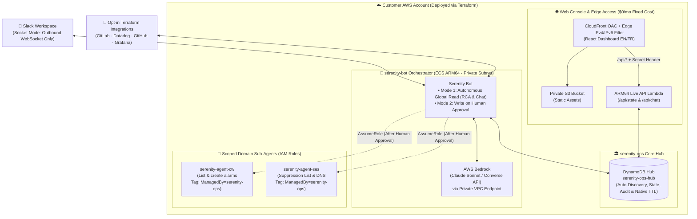

# 🏗️ Architecture, Security & Cost Design

[← Back to Main README](../README.md)

---

## Table of Contents

- [Architecture & How It Works](#architecture--how-it-works)
- [Repository Structure](#repository-structure)
- [Security & IAM Governance](#security--iam-governance)
- [Network & Cost Architecture](#network--cost-architecture)
- [LLM Models: AWS Bedrock & Resilient Fallback](#llm-models-aws-bedrock--resilient-fallback)

---

## Architecture & How It Works



---

## Repository Structure

```text
terraform-aws-serenity-ops/
├── .github/workflows/ci.yml                # Automated CI: Terraform fmt/validate, Pytest & Frontend build
├── main.tf / variables.tf / outputs.tf     # Composable Root Module (enable_core / enable_bot / enable_ses)
├── versions.tf                             # Terraform >= 1.10 & required providers (aws, archive, random)
├── modules/
│   ├── serenity-core/                      # Serverless Core Hub & Live Web Console ($0/hr idle)
│   │   ├── dynamodb.tf                     # Central DynamoDB Hub table (Single-Table Design + native TTL)
│   │   ├── frontend.tf / api.tf            # Private S3 + CloudFront OAC + Edge IP Filter + API Lambda
│   │   ├── lambda/api/index.py             # Python 3.12 Live API handler (/api/state & /api/chat)
│   │   └── front/                          # Bilingual (EN / FR) React 18 + TypeScript + Tailwind Web Console
│   ├── serenity-bot/                       # Independently deployable AI Orchestrator module
│   │   ├── vpc.tf / routing.tf / ecs-cluster.tf # Dedicated VPC, Endpoints & ARM64 ECS Cluster (or BYO-ECS)
│   │   ├── ecs-service.tf / secrets.tf     # ECS ARM64 service, Scoped Observability IAM + Bedrock + sts:AssumeRole
│   │   └── bot/app/                        # Python 3.12 + LangGraph + AWS Bedrock + Slack Socket Mode agent
│   └── serenity-ses/                       # Independently deployable AWS SES v2 Reputation module
│       ├── main.tf / hub.tf / agent-role.tf# Dedicated IP Pool, SNS/SQS, Hub Auto-Discovery & Scoped IAM
│       └── lambda/store-reports/index.js   # Node.js 20 ARM64 Bounce/Complaint processor
├── examples/
│   ├── bot/                                # Standalone Serenity-Bot deployment example (Slack-only or Hub-connected)
│   └── full/                               # Full-suite deployment example (Core Hub + Web Console + Bot + SES)
└── docs/                                   # Architecture, Deployment Guide, Slack App Manifest & assets
```

---

## Security & IAM Governance

`serenity-bot` and its domain sub-agents use a 3-layer permission model (see [`SECURITY.md`](../SECURITY.md) for the full threat model):

1. **Mode 1 (`READ AUTO`):**
   The base orchestrator uses a least-privilege observability read-only IAM policy (`cloudwatch:Describe*/GetMetric*`, `logs:FilterLogEvents/Get*/Describe*`, `ecs:Describe*/List*`, `rds:Describe*`, `cloudtrail:LookupEvents`, `dynamodb:DescribeTable/ListTables`, `lambda:GetFunctionConfiguration/ListFunctions` — excluding `s3:GetObject` and application DynamoDB item reads unless explicitly opted in via `enable_aws_readonly_access`) alongside Terraform-enabled connectors to investigate alerts, correlate logs/commits, and answer chat queries without permission to mutate infrastructure.
2. **Mode 2 (`WRITE ON APPROVAL`):**
   When a remediation or resource creation is proposed, the action enters a `PENDING` state and displays the exact payload in Slack and the Web Console. Execution only happens after an operator clicks **Approve**.
3. **Tag-Scoped IAM Write Boundaries (`ManagedBy=serenity-ops`):**
   Domain sub-agents have scoped write permissions. For example, `serenity-agent-cw` can list existing alarms and create new ones, and can only modify or delete resources carrying its tag, enforced by AWS IAM:
   ```json
   "Condition": {
     "StringEquals": {
       "aws:ResourceTag/ManagedBy": "serenity-ops"
     }
   }
   ```

### Web Console Edge Security & Authentication (`dashboard_allowed_ips` & `dashboard_auth_mode`)
- **Fail-Closed Zero-Cost IPv4 & IPv6 Edge Filtering:** A CloudFront Function (`viewer-request`) is always attached to the Web Console distribution and enforces your IP policy at the edge before requests reach S3 or the Live API Lambda, without requiring AWS WAF. By default (`dashboard_allowed_ips = []`), all requests are denied (`403 Forbidden`) until you specify allowed CIDRs (e.g., `["203.0.113.10/32", "2a01:e0a:123:456::/64"]`, or explicitly `["0.0.0.0/0"]`).
- **Dual-Stack Handling:** If you only specify IPv4 CIDRs in `dashboard_allowed_ips`, `serenity-ops` automatically disables IPv6 (`AAAA`) records on the CloudFront distribution (`is_ipv6_enabled = false`) so dual-stack browsers do not connect over IPv6 and get blocked.
- **Cognito / OIDC Operator Authentication (PKCE + Server-Side JWT Verification):** Enabled by default (`dashboard_auth_mode = "cognito"` at `$0/mo` Free Tier, or `"oidc"` for BYO Okta, Microsoft Entra ID, Google Workspace, Authentik, or Keycloak). The React console performs an OAuth 2.0 Authorization Code + PKCE flow, sends `Authorization: Bearer <jwt>` on all `/api/*` requests, and the Live API Lambda cryptographically verifies RS256/RS384/RS512 signatures against the provider's JWKS. Operator identities are logged in DynamoDB Hub and passed to `sts:AssumeRole` (`RoleSessionName`) for end-to-end AWS CloudTrail attribution.

---

## Network & Cost Architecture

Because **`serenity-core` is serverless** (`DynamoDB PAY_PER_REQUEST` + `Private S3` + `CloudFront OAC` + `ARM64 Lambda`), deploying the Core Hub and Web Console requires no VPC, NAT Gateway, or ECS cluster ($0.00/hour idle cost).

Networking and compute resources are provisioned only when you deploy `serenity-bot`:

1. **Default Self-Contained Mode (`cluster_arn = ""`, `create_vpc = true`):**
   `serenity-bot` provisions its own dedicated VPC, public/private subnets, NAT Gateway (`single_nat_gateway = true` for a single shared NAT Gateway, or `false` for multi-AZ), S3 Gateway & Bedrock Runtime VPC Endpoints, and an ARM64 ECS Managed Instances cluster.
2. **Bring-Your-Own ECS Cluster (`cluster_arn = "arn:aws:ecs:..."`):**
   When you provide an existing `cluster_arn` (with `capacity_provider_name` and `subnet_ids`), `serenity-bot` skips VPC, NAT Gateway, VPC Endpoint, and ECS cluster creation, and runs the bot service directly inside your cluster.
3. **Bring-Your-Own VPC (`cluster_arn = ""`, `create_vpc = false`):**
   Provisions the `serenity-bot` ECS Managed Instances cluster and VPC Endpoints inside your existing `existing_vpc_id` and `subnet_ids`.
4. **Container Image (Pinned `:0.1.3` Image vs Private AWS ECR):**
   - **By default (`create_ecr_repository = false`):** `serenity-bot` pulls `ghcr.io/e-serenity/serenity-bot:0.1.3` so `terraform apply` works out of the box with a reproducible SemVer tag without a local Docker build step.
   - **For production (`create_ecr_repository = true`):** Terraform provisions a private `aws_ecr_repository` in your AWS account and points ECS to it so you do not depend on an external registry. See the **[`modules/serenity-bot` guide](../modules/serenity-bot/README.md#container-image-default-013-vs-private-aws-ecr-recommended-for-production)** for the `docker buildx build --platform linux/arm64` commands to build and push your image.

---

## LLM Models: AWS Bedrock & Resilient Fallback

Serenity-Bot is designed with a multi-provider LLM strategy:
* **Primary (AWS Bedrock — `global.anthropic.claude-sonnet-5-5` by default):** Communicates with Anthropic Claude on AWS Bedrock. For strict regional data residency, configure `llm_primary_model` (or `CLAUDE_MODEL` in Secrets Manager) with a geographic inference profile:
  * **US geo:** `us.anthropic.claude-sonnet-5-5` *(keeps data within US/Canada regions)*
  * **EU geo:** `eu.anthropic.claude-sonnet-5-5` *(keeps data within EU regions)*
* **Optional Fallback (`llm_fallback_provider = "none"` by default):** Disabled by default so data stays strictly within AWS. When desired, set `llm_fallback_provider` and `llm_fallback_model` (e.g., `llm_fallback_provider = "openai"` with `llm_fallback_model = "global.openai.gpt-6.1-sol"`, or `llm_fallback_provider = "gemini"` with `GEMINI_APIKEY`) to automatically fail over if the primary provider is throttled or unavailable.
